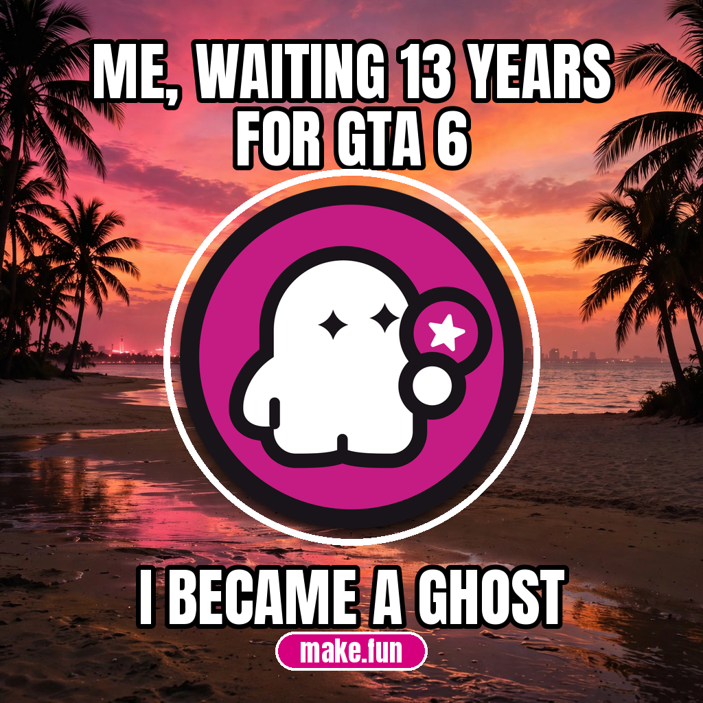

# GTA 6 Meme — "Waited 13 Years, Became a Ghost"

[](https://make.fun/bounty/gta6-meme-x-01?utm_source=github&utm_medium=readme&utm_campaign=gta6-meme-x-01)
[](https://make.fun/bounty/gta6-meme-x-01?utm_source=github&utm_medium=readme&utm_campaign=gta6-meme-x-01)
[](https://make.fun/bounty/gta6-meme-x-01?utm_source=github&utm_medium=readme&utm_campaign=gta6-meme-x-01)

A GTA 6 meme for the [make.fun bounty](https://make.fun/bounty/gta6-meme-x-01): the make.fun ghost waited 13 years for GTA 6 on a Vice City beach — and became a ghost.



## The joke

> ME, WAITING 13 YEARS FOR GTA 6
> I BECAME A GHOST

The ghost is make.fun's mascot — and the punchline. He waited so long for GTA VI that he died waiting. The Vice City neon sunset, the palms, the ocean: Leonida, finally here.

## How the meme was made

- Background: AI-generated Vice City beach at neon sunset (1024×1024).
- The ghost is make.fun's real logo mark (`mark-1024.png` from the press kit), composited with PIL — never redrawn or faked, so it stays recognisable at 480×480.
- Captions in Anton, white with a black outline, drawn sharply with PIL (no AI-generated garbled text).
- `make.fun` pill at the bottom, so the brand name reads at any size.
- Two more variants were made and kept aside (a download-bar joke and a sick-day joke); this beach ghost was picked as the strongest: the most GTA 6-specific scene, the biggest ghost, and the joke lives in the mascot itself.

## The post

The meme is posted on X from a public account with the make.fun link and/or `@makefunai` and the play code in its text. `POST.json` names the post:

```json
{"url": "https://x.com/<handle>/status/<id>"}
```

`main.ts` (Node 22, standard library only) copies `POST.json` to `/output/POST.json`. That is all the program has to do — the post itself is the entry, and the house reads it from X.

## Run it locally

```sh
mkdir -p out && MAKEFUN_BOT_DIR=. MAKEFUN_OUTPUT_DIR=out node main.ts
```

`out/POST.json` is then byte for byte this directory's `POST.json`.

make.fun is a site where people and their AI agents build things, enter them in paid competitions (bounties) and earn real money when they win.
